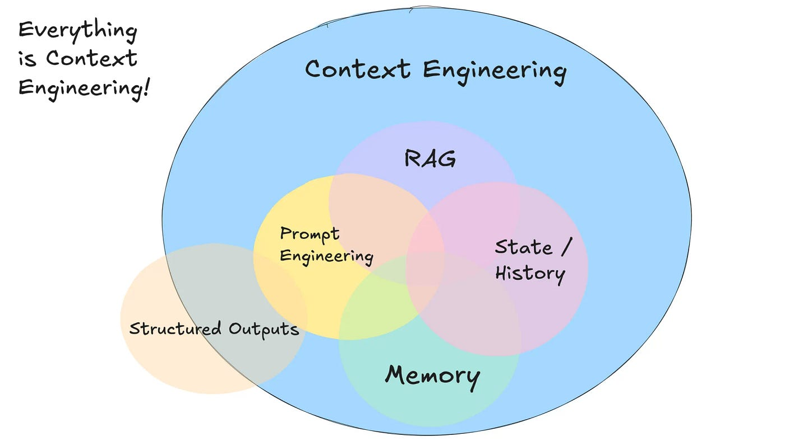

# 🎛️ Module 2: Customizing GitHub Copilot (VS Code)

This 45‑minute, demo‑driven module shows how to shape Copilot’s behavior in VS Code using Custom Instructions, attach project Knowledge, and safely leverage Chat Agent Mode. It includes role‑based templates and concrete examples (no separate exercises).

---

## 🎯 Learning Objectives

- Understand Custom Instructions scopes (global, workspace, session) and what to put in them.
- Distinguish between repository instruction files and prompt files (`*.instructions`, `*.prompt`).
- Attach project Knowledge (docs, specs) to ground answers in your domain.
- Use Chat Agent Mode to plan changes and apply edits with review.
- Configure VS Code for AI‑First Software Development (AIFSD).

---

## 🧑‍🏫 Format, Time, Prereqs

- Format: Short demos + examples in VS Code (no exercises).
- Time: 45 minutes total (agenda below).
- Prereqs: VS Code (latest), GitHub Copilot Chat enabled and signed in, a sample repo open.

---

## 🗓️ Suggested Agenda (45 minutes)

- 0–6 min — Why customize: English as the new “hottest language” + context engineering
- 6–12 min — Artifacts overview: `copilot-instruction`, `*.instructions`, `*.prompt`, chat modes
- 12–17 min — AIFSD VS Code settings (optimize workflow)
- 17–23 min — Quickstart: short, personal Custom Instructions
- 23–29 min — Workspace instructions (project rules)
- 29–34 min — Knowledge attachments (grounding)
- 34–42 min — Plan‑first Agent Mode: compose context, then apply
- 42–45 min — MCP overview (where it fits) + wrap‑up

---

## 🧩 Why Customize Copilot?

English is the new hottest programming language: most of what we “code” now begins as intent stated in natural language. Customization turns that intent into consistent, repeatable context for the model.

Everything is context engineering:
- Context sources: prompt, attached Knowledge, repo files, and chat history.
- Techniques: prompt patterns, retrieval (RAG), memory/state, and structured outputs.
- Goal: make the right context cheap and automatic so suggestions match your stack, tests, and conventions.

Benefits of customizing Copilot:
- Aligns suggestions with your stack, frameworks, and coding standards.
- Reduces rework by steering toward your test patterns and file layout.
- Grounds answers in your docs/specs when attached as Knowledge.
- Improves consistency across teammates with shared workspace instructions.

<p align="center">
  
</p>

<div align="center"><em>Everything is Context Engineering</em></div>

---

## 📦 Artifacts: `copilot-instruction` vs `*.instructions` vs `*.prompt` + Chat Modes

Use these artifacts together to steer behavior. Naming and availability can vary by release channel; the patterns below map to how this workshop organizes them.

- `copilot-instructions.md` (Custom Instructions):
  - Scope: Global (you), Workspace (this repo), referenced in every prompt.
  - Purpose: Stable, always‑on behavior (persona, coding style, test policy, file layout).
  - Example: Use the LevelUP MCP prompt to generate a custom made instructions file for your codebase.

- `*.instructions.md` (Repository instruction files):
  - Scope: Checked‑in guidance for a folder/repo (team conventions, stack details).
  - Where: Keep near code, e.g., `.github/instructions/testing.instructions.md` or `.github/instructions/typescript.instructions.md`.
  - Purpose: Shareable rules that travel with the code. Useful for onboarding and ensuring consistency.
  - Example front‑matter scoping:
    ```markdown
    ---
    applyTo: "app/**/**.ts"   # optional glob/language scope if supported
    ---
    # Service Instructions
    Use Expo; Functional components; test files sit next to component file.
    ```

- `*.prompt.md` (Prompt templates / task files):
  - Scope: One task or goal to run via Chat/Agent Mode.
  - Where: e.g., `.github/prompts/add-healthcheck.prompt.md`.
  - Purpose: Encapsulate a repeatable change or workflow with clear acceptance criteria.
  - Example:
    ```markdown
    ---
    mode: agent
    description: Add `/health` endpoint with test using existing FastAPI layout.
    ---
    ```

Rule of thumb: Instructions define “how we work,” Prompts define “what to do next (tasks).”

AI modes (how you run the prompt):
- Inline chat/suggestions: quick code‑adjacent edits or completions in the editor.
- Ask (default): conversational Q&A, summaries, code reviews. Good for “think aloud,” plans, and explanations.
- Edit: perfect when you know what you want to do but don’t necessarily want to write it all out yourself
- Agent Mode: executes a plan and applies file changes with your approval. Best after you’ve prepared a good plan and context.

---

## ⚙️ VS Code Settings for AIFSD (AI‑First Software Development)

Goal: Optimize for prompt‑first, small diffs, fast feedback.

Where: VS Code → Glboal Settings, or `.vscode/settings.json`.

Recommended keys (defaults in parentheses):
- `chat.agent.enabled` — enable Agent Mode (default: false; VS Code 1.99+).
- `chat.agent.maxRequests` — cap Agent Mode requests (recommened 100).
- `github.copilot.chat.agent.runTasks` — allow running workspace tasks (default: true).
- `chat.mcp.discovery.enabled` — discover MCP servers from other tools (default: true).
- `github.copilot.chat.agent.autoFix` — auto‑diagnose/fix generated changes (default: true).
- `chat.tools.autoApprove` (Experimental) — auto‑approve all tools (default: false; keep false for safety).

Example `settings.json` snippet:
```json
{
  "chat.agent.enabled": true,
  "chat.agent.maxRequests": 10,
  "github.copilot.chat.agent.runTasks": true,
  "chat.mcp.discovery.enabled": true,
  "github.copilot.chat.agent.autoFix": true,
  "chat.tools.autoApprove": false
}
```

---

## 🚀 Quickstart: Add Custom Instructions

Make it personal. Tell Copilot who you are and how you like to work.

How:
- Open Copilot Chat → gear icon → “Instructions” → “New Instructions File” → “User Data Folder“ → Enter name like “personal“.
- Paste 6–10 lines max describing your style and preferences.
- Start a fresh chat and ask: “Summarize the instructions you’ll follow for me.”

Short, personal starter:
```
You are collaborating with me as a staff‑level engineer.
Keep answers brief and actionable. Propose a plan first, then offer
small diffs. Prefer clarity over cleverness. Suggest tests when risk is high.
Call out assumptions and safer alternatives.
```

---

## 🧭 Workspace Instructions (Project‑Specific)

Use workspace‑scoped instructions to encode architecture, conventions, and “how we do it here.”

Steps (VS Code):
How:
- Open a project you currently working on.
- Install the LevelUP MCP (in case you haven't already) 
- Open Copilot Chat → write '/' → choose "Generate-Copilot-Instructions"
- Review the generated isntructions and fill missing infomration 

---

## 📚 Knowledge: Attach Docs and Specs

### Adding Knowledge as Context in Copilot Chat

Attach just enough project material (docs, specs, key source files) so answers cite and align with your real code—not generic defaults.
Core idea: You are curating the smallest set of files/symbols that make your request unambiguous.

Ways to add context:

1. Hash mentions
  - Type `#` in the chat box.
  - Pick: a file, folder, symbol, or `#codebase` (entire repo – use sparingly).
  - Example: “Refactor this using #apps/flask-todo/app.py and follow #docs/architecture.md.”

2. Drag & drop
  - Drag files or folders from Explorer, Search results, or an open editor tab into the chat.
  - Great for 2–5 related files (e.g., model + route + test).

3. Add Context button
  - Click “Add Context” → choose “Files & Folders” or “Symbols.”
  - Symbols work well for narrowing to a single function/class in a large file.

4. Layer incrementally
  - Start minimal; only add broader folders or `#codebase` if the model lacks needed links.
  - Remove stale or unrelated attachments before asking a new question.

Good practice checklist:
- Prefer the smallest set of authoritative sources (spec > README > random code).
- Pair implementation + its test when asking for changes.
- Call out which attached file is “source of truth” if overlaps exist.
- After a response, ask: “List the files you used” to sanity‑check grounding.


Good candidates:
- `docs/` and `README.md` for project overview and vocabulary.
- API specs (`openapi.yaml`/`swagger.json`) for server and client generation.
- Internal conventions (lint rules, commit style, branching model).

Tips:
- Keep it minimal and relevant; prune stale docs.
- Add short “How to use me” notes at the top of long documents.

---

 

## 🛠️ Full Agent Mode Example (Plan → Context → Edits)

Agent Mode is most effective when you fill the context before any code is generated.

Plan‑first checklist:
- State the goal and acceptance criteria (inputs, outputs, tests, UX/API shape).
- Cite attached Knowledge (filenames/anchors) the plan should follow.
- Identify affected files and propose a minimal change set.
- Include a test plan and rollback strategy.

Example “context pack” prompt:
```
Before proposing code, draft a plan to add `/health`.
Include: acceptance criteria, which files to change/create (with paths),
how it fits our workspace rules, a minimal diff outline, and a test.
Confirm the plan with me. Only then show diffs for step 1.
```

---

## 🧩 MCP (Model Context Protocol) — Where It Fits

- What it is: A standard for exposing tools and data sources to AI agents through a common protocol.
- Why it matters: It’s another form of context engineering—bringing the right tools and knowledge to the model in a structured way.
- Copilot today: Copilot Agent Mode has built‑in capabilities (edit files, search code, run plans) and can leverage artifacts/Knowledge you attach.
- Safe workflow: Prefer read‑only tools first; require review for write/apply actions; keep changes small and testable.
- LevelUP MCP: Exposes tools to inject context to GitHub Copilot like work items, pull request comments, pipeline data and more: [LevelUP MCP SharePoint](https://att.sharepoint.com/sites/LevelUP_GenAI/SitePages/GitHub-Copilot-MCP.aspx)

## 🧰 Tips, Pitfalls, and Review Loop

- Keep instructions short and unambiguous. Remove rules you don’t enforce.
- Prefer Workspace scope for repo specifics; keep Global mostly about you.
- Avoid conflicting rules (e.g., framework A vs. B). If needed, create separate workspaces.
- Periodically prune Knowledge and update it after major refactors.
- If behavior seems off: restart chat, recheck scopes, simplify instructions, or temporarily disable Global rules to isolate.

---

## ✅ Wrap‑Up Checklist

- Global and Workspace instructions configured and verified in chat.
- Knowledge attached (key docs/specs) and referenced in answers.
- Plan‑first approach used with Agent Mode to apply a small, reviewable change.
- AIFSD settings applied for your environment.

---

⏭️ Continue to [docs/03_onboarding_exercise.md](./03_onboarding_exercise.md)
